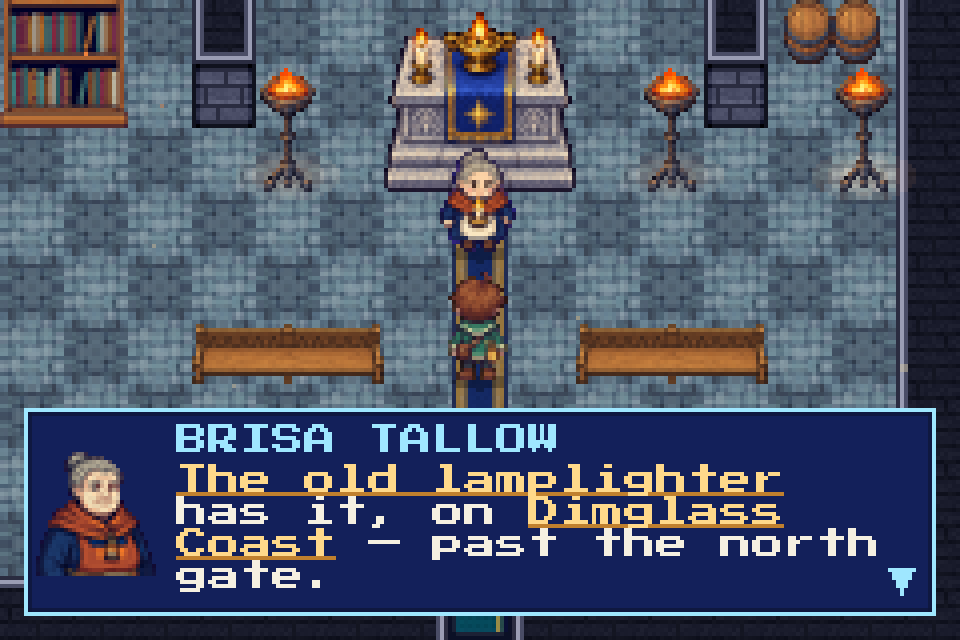

# The Dialogue Pace Rubric

*Binding for every line of in-game text: NPCs, signs, cutscenes, trainer lines, kin chatter.*

Playtest feedback (2026-11): the early game spends too long reading, and it is hard to
tell **story-critical information** from colour. This rubric is how we fix both
without flattening the world's voice. It balances three things we sell at once:

| We sell | Too little | Too much |
|---|---|---|
| **Lore**: a world that feels lived-in and a little melancholy | cardboard towns, nobody has a past | a lecture between you and the next route |
| **Intrigue**: questions you want answered | nothing to wonder about | the answer given away in the same breath |
| **Pace of play**: the next step is always one walk away | (never the failure) | four pages to learn "go north" |

The rule of thumb: **the player chose to talk; reward them fast, then let them go.**

## 1. The box, in numbers

The box shows **4 rows of 27 characters** (23 beside a portrait bust): roughly **100
characters a page**. Every page costs a button press and a beat of attention, so the
budgets below are in characters per authored line (the box paginates long lines itself).
`node tools/content/dialogue_stats.mjs --budget` measures the whole game.

## 2. Tiers and budgets

Classify each line by its job before touching it. The tier sets the budget.

| Tier | What it is | Per line | Per interaction | Treatment |
|---|---|---|---|---|
| **T1 Story beat** | main-path cutscenes: Fenn's ceremony, Gleam relights, Còr, the rival's turns, the ending | ≤240 | as the scene needs | Keep the emotion, the voice and the silences. Cut restatement, not feeling. Aim for −15–25%. |
| **T2 Directive** | anyone who tells you what to do next: quest-givers, gate-keepers, Andrew's hints, tutorials | ≤160 | ≤4 pages | The instruction comes FIRST (on page one), plainly, and is marked. Preamble is the first thing cut. |
| **T3 Character** | townsfolk, regulars, repeat-talk, trainer intros and outros | ≤160 (aim ≤100) | ≤3 pages | One idea, one joke, one voice. If two lines say the same thing, keep the better one. |
| **T4 Sign / object** | signs, notices, examined props | ≤100 | 1–2 pages | Name, direction, one line of character. |
| **T5 Optional depth** | lore-keepers, the Hollowing's own people, diaries, side-quest backstory the player sought out | ≤240 | as earned | The player opted in, so depth is the reward. Still trim; never pad. |
| **T6 After / repeat** | what an NPC says once their quest is done, or on the second talk | ≤100 | 1–2 pages | A warm send-off, not a recap. |

Hard ceiling: **no line over 300 characters anywhere** (three pages). A line over 160 must
be T1 or T5 and earn it.

## 3. Scoring a line

Score each line 0–2 on five axes. Low-scoring lines get trimmed, merged or cut.

| Axis | 0 | 1 | 2 |
|---|---|---|---|
| **Purpose** | says what the last line said | colour only | moves story, directs, or reveals character |
| **Density** | most words are throat-clearing | some padding | every clause carries weight |
| **Voice** | could be anyone | generic cosy | unmistakably this character (Fenn's formality, Wren's cheek, Còr's gentleness) |
| **Pace cost** | over the tier budget | at budget | under budget |
| **Key info** | the critical part is buried or missing | present but unmarked | first, plain, and marked |

- **8–10:** keep (light polish at most).
- **5–7:** trim to budget; keep the best clause of voice.
- **0–4:** cut, or merge into its neighbour.

*Voice is weighted*: never trade a 2 on Voice for a 2 on Pace. Shorten **around** the
character's tics rather than through them. A line that is short but could be spoken by
anyone has failed.

## 4. What we always preserve

- **Directions and requirements**: the compass point, the landmark, who to ask, what to bring.
- **First naming of canon** (a new place, Gift, kin, person, festival) on the main path.
- **Seeds and dread**: the Hollowing's quiet early presence, the dosed Senna thread, the
  Long Dusk's cost. These are intrigue; leave the question open.
- **Payoffs**: a joke or reveal whose setup was earlier. Cut the setup and you cut both.
- **Puzzle text**: riddles, clues, typed answers, and anything an `askName` checks.
  The Wanderwood's Tolkien line is quoted verbatim on purpose.
- **Tokens and names**: `{name}`, item/move/kin names, speaker names, portraits.
- **The hidden real-people rules** (CLAUDE.md): nothing new may point at that content.

## 5. How we trim (in order)

1. **Cut the throat-clearing.** "Well, you see, the thing is…", "As I was saying…",
   "I suppose what I mean is…". Start on the noun.
2. **Merge restatements.** Two lines by one speaker that say one thing become one.
3. **Lead with the ask.** In T2 lines, the instruction moves to the front.
4. **One image, not three.** Keep the most specific detail; drop the lists of similes.
5. **Let the world show it.** If the map, a sign or the journal already tells the player,
   the NPC doesn't need to recite it.
6. **Never cut a step that does work.** Flag-guarded steps (`if_flag`/`unless_flag`) and
   non-text ops stay; shorten their text instead.

## 6. Marking key information: `[[like this]]`

Text wrapped in `[[double brackets]]` renders **underlined in lamp-gold** in the dialogue
box (`DialogueBox`, parsed by `ui/textMarks.ts`), so story-critical information can't be
missed in a stream of colour. Mark:

- **where to go next** (`[[north, past the cliffs]]`, `[[Pearlmoor]]`),
- **who to see** (`[[the netmender]]`),
- **what to bring or do** (`[[ring the Causeway Bell]]`, `[[catch a kin]]`),
- **a new mechanic or Gift, and its control** (`[[raise your LAMP]]`).

Do **not** mark lore, flavour, jokes, emotion, or names that are only colour. Mark the
phrase, not the sentence (≤ about 5 words), and at most **two marks a line**. If
everything is underlined, nothing is. Signs mark only their destinations. Marks are
stripped everywhere text isn't drawn by the DialogueBox (battle messages, menus).

## 7. The 2026-11 pass: targets and results

| Measure (dialogue_stats.mjs) | Before | Target | After |
|---|---|---|---|
| Characters, whole game | 653,756 | −25–35% | 491,222 (−25%) |
| Early game (first-hour scripts, school, South, signs/NPCs) | 145,797 | −35–45% | 92,119 (−37%) |
| Lines over 160 characters | 908 | T1/T5 only | 67 |
| Lines over 300 characters | 3 | 0 | 0 |
| Key-information marks | 0 | on every T2 directive | 901 |

Real-people cameo content and verbatim-flagged walkthrough lines were trimmed only lightly,
and riddle text was left intact, which is why the whole-game cut sits at the low end.
New content should be written to the budgets above rather than trimmed later.
