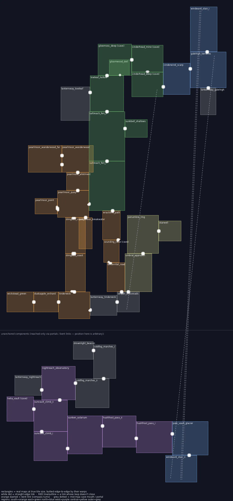
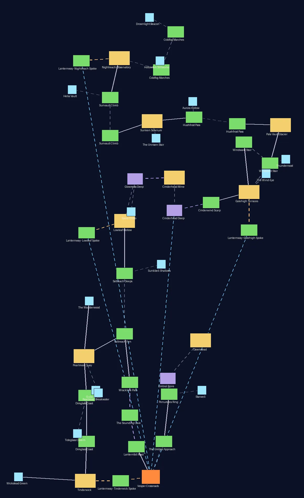

# The honest world — Vesperholm's walked geometry (2026-10)

**Rule:** leave a map by its north edge and the next map *is* north of it — on the
ground, on the MAP screen and in every direction a character gives. No road leaves
one edge and arrives on another edge, and no single road crosses territory that other
maps already occupy. Long distances are covered by more road, or by a ride the world
explains (the Lantern-car).

`tools/maps/world_geometry.py` proves this, and runs in CI with `--check`. It lays
every outdoor map out edge to edge at its true tile size, starting from Tinderwick,
then FAILs on any of these:

- a loop that doesn't close (a *misclosure*);
- two maps claiming the same **dry** ground (an *overlap*). A cave under a surface
  map is underground, and two maps showing the same bay are one sea, so neither
  counts;
- a MAP-screen road that runs in a different direction from the edge you walk off.

## The shape

The journey climbs **north**: up the Dimglass coast to Pearlmoor, through the fens to
Lowleaf, under Glowmoss and Cinderhead, then up Cinderwind Scarp onto Galehigh. From
there it goes north again up Windward Stair to Pale Vault, west along the top through
Hushfrost and the Solarium, and north up Sunvault to Nightreach. The **Vesper
Crossroads** sits beside Tinderwick at the foot of the dark mountain, and the
**Umbral Spire** rises north of it.

| Leg | What's walked | Added in this pass |
|---|---|---|
| Pearlmoor → home | Saltreach Fen I's *drowned road* (south edge) → Wrackline Path → Sounding Cave (upright) → Lanternfall Road → the Crossroads' north-west road | the loop round the bay (Pearlmoor's west road now runs to the Point beach) |
| Cinderhead → Galehigh | Cinderhead Deep → **Cinderwind Scarp** → Galehigh | new route, lv 28–31; closes the level gap after the Deep |
| Hub → Spire | the Crossroads' north road → **Umbral Approach** → Penumbra Ring → Spire | new route, lv 50–53; Wren's join band moves onto it |
| Nightreach's marshes | Nightreach (east fog gate) → Coldfog Marches II → Marches I (north) → Drownlight Beacon (off Marches I's west flank) | the marsh road from the Crossroads is retired; an old save stranded in Marches I without Emberward wakes at its rest point (`STRANDED_WITHOUT` in `WorldScene`) |

## The Lantern-car (rides, not roads)

Lowleaf, Galehigh and Nightreach sit high on the mountain's flanks, days on foot from
the Crossroads. Their Lanternway lanes end at **Lantern-car stations**: the Galehigh
kite-wrights' lamp-winch (`galehigh_winch`), with a Confirm trigger on its base. The
Crossroads keeps the main winch on its east platform (`script.lantern_car`).

- **Riding up** a line needs that valley's Gleam: the old per-town spoke rule
  (verdant / storm / lunar).
- **Riding down** always works (`script.lantern_car_down_<line>`), because the car
  rolls home under its own weight.
- **The ride itself** is the `travel` cutscene op: fade out, enter the map, fade in.
  It isn't a warp, so it isn't a `graph.ts` edge, just like waystone TRAVEL.
- **On the MAP**, rides draw as sky-blue dotted lines (road kind `car`). The
  Cinderhead ore-hoist is drawn the same way.

## Deep water

Tidecall swims the **shallows**. Past a two-tile shelf along every shore, the open
sea is **deep**:

- **Art:** the `deepwater_set` accent family (`tools/maps/build_deepwater_set.py`) —
  darker, with a slower swell.
- **Gate:** the reserved `deepdive` ability, which no Gift grants yet. A future
  deep-swim mechanic is one `reward_abilities: ['deepdive']` away.
- **Where it applies:** sea maps call `mk.deep_water(m)` before `finalize()`. It
  keeps a shallow channel to every islet and to anything placed on the water.
  Marsh, fen, pond and sun-pool water stay shallow.
- **Overrides:** a Tidecall `AbilityGate` never softens deep water under it.
- **In play:** bumping into deep water while swimming explains itself once per map
  visit (`world.too_deep`).
- **Designed swim lanes stay shallow:** pass a Tidecall gate's rect as `keep_rects`
  (Pearlmoor's harbour gates are the worked example — its rarer Tide kin live there).
  Gullcry and Hearthfall gate their whole sea row by row, so they don't keep theirs.

## The MAP screen

`tools/maps/world_layout.py` (CI: `--check`, fails if `worldmap.json` is stale) places every node at its **real** centre, taken from
the walked layout. Caves and landmarks sit at their mouth tile. Only node *kinds* are
authored. The world is tall, so `ui/WorldMapMenu.ts` fits the width and scrolls with
the cursor, with ▲/▼ hints shown when there's more above or below.

